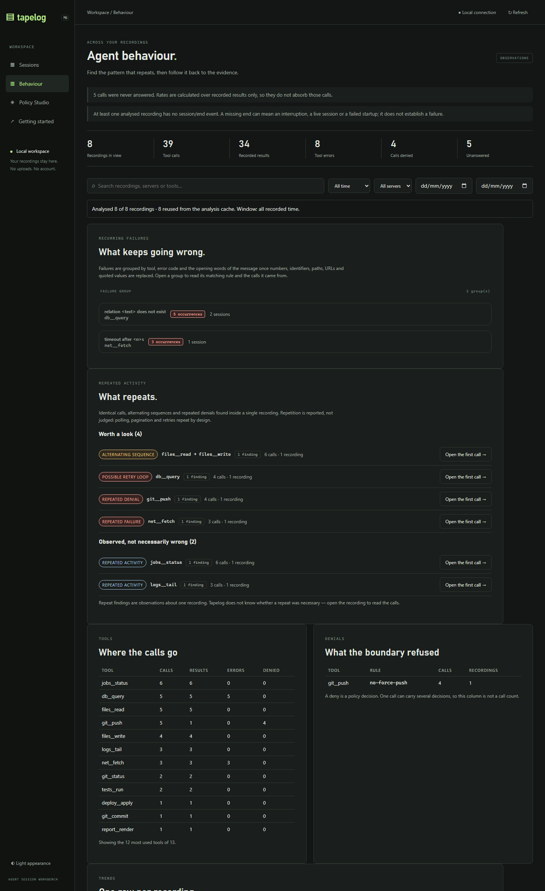
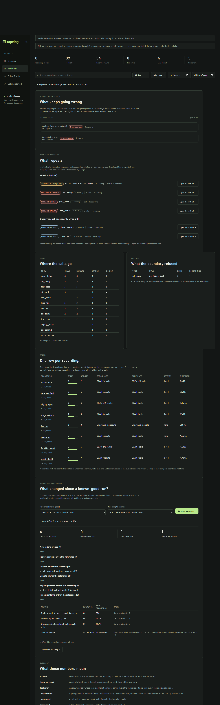
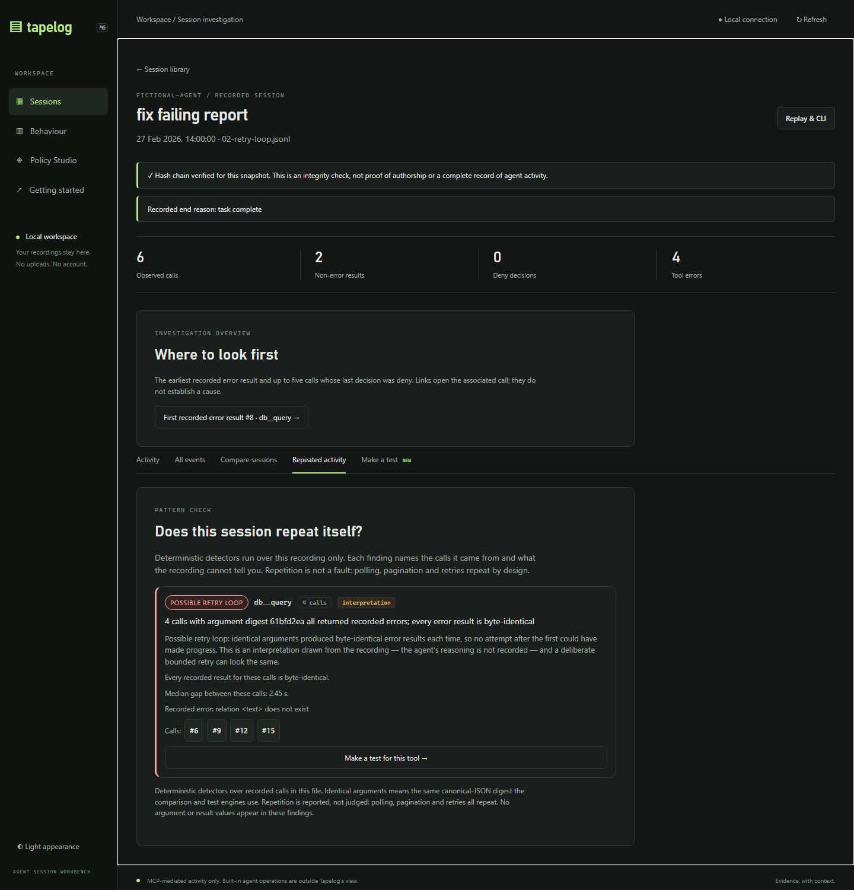
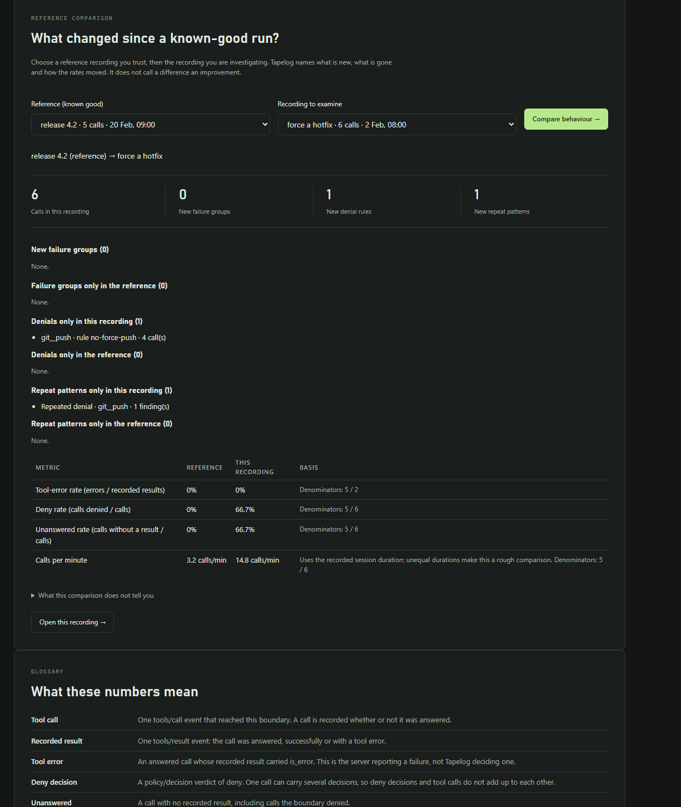

# TAPELOG — M6: Agent Behaviour Intelligence

**Assigned agent:** Terra · **Role:** lead product engineer, Go developer and developer-experience specialist
**Branch:** `feat/m6-agent-behaviour-intelligence`, created from `fix/m5-1-policy-pack-correctness`
**Baseline:** `ba39ec0` "docs(review): record M5.1 policy-pack correctness evidence" (M5's `b2b905d` plus the M5.1 policy repair)
**Nature:** product development, not release preparation. Not pushed, not merged.

M2–M5 made one recording at a time explorable: a library, an investigation
timeline, a comparison, a policy studio. This milestone answers a different
question — **what keeps happening across recordings** — and then sends the
developer back into the evidence, into `tapelog test`, or into the policy
studio, using the interfaces that already exist.

Everything below is derived from what Tapelog actually mediated:
`tools/call`, `policy/decision` and `tools/result`. The workbench still cannot
see agent reasoning, prompts, token usage, model calls or built-in client
operations, and no screen in this milestone implies otherwise.

---

## 1. Verified baseline

| Item | Value |
| --- | --- |
| Branch point | `fix/m5-1-policy-pack-correctness` at `ba39ec0` |
| Working branch | `feat/m6-agent-behaviour-intelligence` |
| Implementation commit | `e76becb` "feat(behaviour): find recurring problems across recordings (M6)" |
| Go | 1.27.3 windows/amd64 |
| Node (frontend tests only) | v26.5.0, `node --test` with no extra dependencies |
| Policy engine (unchanged) | `github.com/cedar-policy/cedar-go` via `internal/policy/cedar.go` |

```powershell
$env:GIT_PAGER='cat'
git switch -c feat/m6-agent-behaviour-intelligence   # from ba39ec0
go build ./... ; go vet ./... ; go test ./...        # green before any change
node --test internal/web/static/app.test.cjs         # 17 pass before any change
```

The M5.1 enforcement suites were green at the branch point and are still green
after this milestone (§8).

## 2. Research (Phase 0)

Five sources shaped the design. Two of them changed it.

### 2.1 Hermes Agent issue #512 — "Doom Loop Detection"

<https://github.com/NousResearch/hermes-agent/issues/512>

The request: when an agent gets stuck it "often manifests as calling the same
tool with identical arguments repeatedly — searching for the same pattern,
re-reading the same file, or retrying the same terminal command". Kilocode
responds by pausing for confirmation after **3 identical consecutive calls**
(`(name, args)` tuples). The issue notes Hermes already detected repeated
*errors* (invalid tool name 3×, invalid JSON 3×) but not repeated identical
*successful* calls, and that "an agent can call `search_files("pattern", "/")`
10 times in a row without any safety mechanism triggering".

**This changed our design.** The thread records that earlier attempts were
blocked because maintainers could not "reliably distinguish legitimate repeated
calls from no-progress loops", and a long comment argues the objection dissolves
if you key on **`(tool, args, result)`** instead of `(tool, args)`:

> "A legitimate repeated read/poll/build returns different output when something
> changed — it never trips. A poll that legitimately returns identical output is
> the known exception … You are no longer asserting 'this tool is safe to
> repeat'; you are observing 'this specific call produced byte-identical output
> N times running, so the Nth+1 cannot be making progress.'"

So Tapelog's strongest detector is **identical arguments *and* byte-identical
error results**, classified as a *possible* retry loop. Identical arguments with
differing detail stay a weaker "repeated failure", and identical arguments with
changing output are reported as plain activity — exactly the polling exception
the thread names. That is also why every finding carries a `confidence` of
`observed`, `possible` or `insufficient`.

### 2.2 MCP Inspector v2 UX specification — History Screen

<https://github.com/modelcontextprotocol/inspector/blob/main/specification/v2_ux.md>

The proposed History screen is a per-connection request log: filter by method
type, status (success/error) and time range; search across "method names,
parameters, and responses"; show or hide child requests; export as JSON; replay
an entry back into the right screen with the form pre-filled.

This is the closest prior art to "look back at what happened", and it stops at
one connection. It confirms the gap rather than filling it: no cross-session
grouping, no pattern detection, no notion of a recurring failure. We borrowed the
interaction vocabulary (filter by status and time, search across recordings,
click through to the request) and not the scope.

### 2.3 Langfuse sessions

<https://langfuse.com/docs/observability/features/sessions>

Langfuse groups traces by `sessionId`, replays "the entire interaction", and
supports session-level scores and bookmarks. What it does not advertise is any
analysis of what a tool call *did* — no repeated-call detection, no failure
clustering by error content, no denial-rate view. Session observability platforms
give you the container; the pattern work is left to the reader.

### 2.4 Arize Phoenix

Phoenix models observations as spans and traces (OpenInference semantic
conventions) and treats a session as a group of traces. Its evaluation tooling is
LLM-as-judge and dataset-based, not "did this trajectory repeat itself". Useful
as a contrast: Phoenix answers *was this a good response*, Tapelog answers *was
this the same call again*.

### 2.5 Requested functionality versus our own ideas

| Idea | Source | What we did |
| --- | --- | --- |
| Detect repeated identical tool calls | Hermes #512 (requested) | Implemented, with the `(tool, args, result)` calibration from the same thread |
| Distinguish polling from a stuck loop | Hermes #512 commenters (requested) | Implemented as a classification rule; polling reads as activity |
| Look back over past interactions, filter, click through | MCP Inspector (requested) | Implemented as the overview, the repeat tab and deep links |
| Group failures across sessions by error identity | our own product idea | Implemented, with an explainable signature and a visible matching rule |
| Trends over recordings | our own product idea | Implemented conservatively: rates with denominators, no verdicts |
| Compare against a known-good recording | our own product idea (extends M4) | Implemented at the behaviour level; call-level stays in M4's Compare tab |
| Turn "this error must not recur" into a test | our own product idea | Implemented in the engine (`result_never_contains`), not only the UI |
| Guardrail that pauses the agent mid-run | Hermes #512 (requested there) | **Out of scope**: Tapelog is a recorder and boundary, not an agent runtime |

### 2.6 What Tapelog can and cannot infer

| Question | Answerable from a recording? | How |
| --- | --- | --- |
| How many calls, results, errors, denials? | yes | counted per event type (§4.1) |
| Did this exact call repeat? | yes | canonical-JSON argument digest, the same one the engine uses |
| Did it make progress? | **only partly** | byte-identical results are evidence of no progress; differing results are not evidence of progress |
| Was the repetition necessary? | **no** | polling, pagination and retries repeat by design |
| Why did the agent repeat it? | **no** | reasoning is not in the log |
| What did a denial cost, in tokens or money? | **no** | not recorded |
| Did the client's built-in tools run? | **no** | never crosses the boundary |

That table is why every finding ships with an interpretation that states what it
cannot know.

---

## 3. What was built

### 3.1 Behaviour Overview (`#behaviour`, sidebar → Behaviour)

One bounded pass over the recording library, rendered as: a metric strip, the
filter bar (search, date range or fixed window, server), a coverage line that
says exactly what was read, recurring failure groups, repeated activity, tool
usage, denials, a trend table, the reference comparison and a glossary.





### 3.2 Repeated activity, inside one recording

A new **Repeated activity** tab in the session view runs the detectors over the
open file only, shows each finding with its evidence, its interpretation, the
call identifiers it came from (clickable, jumping to the timeline) and the
median gap between the calls.



### 3.3 Recurring failure groups, across recordings

Groups are keyed by tool, error code and the normalised opening words of the
message. Expanding a group shows **why** it was grouped (the matching rule in
words), the recorded error code, first and most recent occurrence, a stable
phrase usable in a regression test, the recordings it came from, and a
**Draft a regression test for this error →** button.

### 3.4 Trends

One row per recording, oldest first: calls (with a proportional bar), results,
error rate with its denominator, denial rate with its denominator, repeat
findings (`attention-worthy of total`), duration. A dash is used where a
denominator is zero, never `0%`.

### 3.5 Known-good comparison

Pick a reference recording, pick the recording to examine, and Tapelog names new
and resolved failure groups, new and resolved denials, new and resolved repeat
patterns, and four metrics with their denominators. It states in the response
that a difference is not a regression.



### 3.6 The absence assertion (engine, not just UI)

`tapelog test` gained one assertion:

```yaml
assert:
  - result_never_contains: { tool: db_query, text: "does not exist" }
```

Generated from a real failure in the workbench, run by the real engine, reported
like every other assertion. Running the generated test against the recording
that motivated it *fails*, which is the point: it states the behaviour you want
next time. Semantics and limitations are documented in
[`docs/TESTING.md`](../TESTING.md#absence-assertions).

### 3.7 Workflow wiring, not a parallel universe

| From | To | Mechanism |
| --- | --- | --- |
| Failure group | the recorded call | occurrence links open the session at that call |
| Failure group | the replay engine | "Draft a regression test" opens the existing Make-a-test tab with `error_absent` selected |
| Recorded call | policy studio | the existing inspector's "Create policy proposal →" is unchanged and still the only route |
| Repeat finding | the timeline | call chips (#6, #9 …) paginate to the call and select it |
| Comparison | the call-level diff | "Open this recording →" hands over to the M4 Compare tab |
| Anywhere | a shared link | `#behaviour&a=…&b=…` opens a comparison; `#session=…&tab=repeats` opens a tab |

### 3.8 A reproducible demo library

```powershell
go run ./tools/gen-m6-demo m6-demo-sessions
tapelog web --dir ./m6-demo-sessions        # → http://127.0.0.1:8923
```

`tools/gen-m6-demo` writes eight synthetic recordings through the **real session
writer**, so they have valid hash chains and behave exactly like captured
evidence. `tapelog verify` accepts them:

```
OK: m6-demo-sessions\02-retry-loop.jsonl
  21 events, chain intact
```

The set covers every shape Phase 9 asks for: repeated successes, legitimate
polling, identical repeated failures, an alternating sequence, changed policy
outcomes, a missing `session/end`, a discovery-only connection, redacted-looking
values and a clean reference run.

---

## 4. Detector semantics

### 4.1 Counting definitions (the numbers cannot be confused)

| Term | Definition | Where it comes from |
| --- | --- | --- |
| Tool call | one `tools/call` event | `session.EventToolCall` |
| Recorded result | one `tools/result` event (answered, success or tool error) | `session.EventToolResult` |
| Tool error | an answered call whose result carried `is_error` | `is_error` on the result payload |
| Deny decision | a `policy/decision` verdict of `deny` | one **decision**, not one call |
| Unanswered | a call with no recorded result, which includes denied calls | derived |
| Discovered | a `tools/list` event; nothing was invoked | `session.EventToolsList` |

Denials are counted twice on purpose and both are exposed: `denies` (calls whose
last recorded decision was deny) and `deny_decisions` (decision events). They are
not interchangeable, and the glossary that ships **inside the API response** says
so. Rates always carry the denominator they were computed over; a zero
denominator yields `null`, which the interface renders as
`undefined · no results`, never as `0%`.

### 4.2 Thresholds

| Constant | Value | Why |
| --- | --- | --- |
| `minRepeatCount` | 3 | Two occurrences are a coincidence or one retry; three is the lowest number that can distinguish a pattern from an accident, and it matches the threshold Kilocode/Hermes converged on |
| block lengths | 2, 3, 4 | shorter blocks are the group detector's job; longer blocks overfit one recording |
| `maxFindingsPerSession` | 20 | a pathological recording must not flood the page |

### 4.3 The detectors, and how a group is classified

Grouping first: calls are bucketed by `(tool, canonical-JSON argument digest)`.
Unreadable arguments are skipped rather than bucketed together, because grouping
on "no arguments" would over-merge unrelated calls.

| # | Kind | Trigger | Confidence |
| --- | --- | --- | --- |
| 1 | `repeated_denial` | every call in the group was denied, ≥3 | observed |
| 2 | `possible_retry_loop` | every call errored **and** every error result is byte-identical, ≥3 | **possible** |
| 3 | `repeated_failure` | every call errored, ≥3, error detail differs | observed |
| 4 | `repeated_failure` | ≥2 errors mixed with other outcomes | observed |
| 5 | `repeated_activity` | every call produced a result, ≥3 | observed |
| 6 | `insufficient_evidence` | every call is unanswered | insufficient |
| 7 | `insufficient_evidence` | only two identical calls (below threshold) | insufficient |

Precedence is exactly that order. Sequences are detected before groups:

| Kind | Trigger | Notes |
| --- | --- | --- |
| `alternating_sequence` | a 2-call block repeats ≥3 times in order with identical arguments | reported as "two calls alternated N times" |
| `repeating_block` | a 3- or 4-call block repeats ≥3 times in order | reported with its block length |

The block scanner walks left to right, takes the smallest block length that
qualifies at each offset, consumes the match, and requires **at least two
distinct calls inside the block**. Without that last rule a run of six identical
polls matches "block `[A,A]` repeated 3 times" and a polling tool gets labelled
an alternating sequence — a defect this milestone's tests caught and fixed
(`TestBehaviourLegitimatePollingReadsAsActivityNotALoop`).

Each finding carries: the kind, the tool(s), the count, the longest consecutive
run, the repeat count, the call identifiers (`seqs`), the first and last call,
whether results were byte-identical, the median gap between the calls when
timestamps exist, a one-sentence evidence line, and an interpretation.

### 4.4 What the detectors deliberately do not do

- They do not call anything an infinite loop, wasted work or a stuck agent.
  `possible_retry_loop` is the strongest claim, is marked `possible`, and its
  interpretation says a deliberate bounded retry looks the same.
- They do not treat repetition as a fault. `repeated_activity` is filed under
  "Observed, not necessarily wrong".
- They do not use wall-clock behaviour as evidence. The median gap is reported,
  not thresholded: a 20-second poll and a 2-second burst both read as data.
- They do not infer intent, cost or progress beyond "byte-identical output
  cannot represent progress".
- They are deterministic: same recording, same findings, same order, and the
  overview API publishes its own thresholds so a reader can check them.

---

## 5. Failure-group matching semantics

### 5.1 Reading a failure

`signatureFor(tool, server, body)` accepts the shapes MCP servers actually emit:
the JSON-RPC `error` object (`code` + `message`), a bare `message`, a JSON string,
or `content[].text` blocks. When no text exists the group still exists, labelled
"Error reported with no recorded message" — silent failures are worth grouping
too.

### 5.2 Normalisation, step by step

Applied in this order, so a reader can replay it by hand:

| Step | Replaces | With |
| --- | --- | --- |
| 1 | URLs | `<url>` |
| 2 | UUIDs | `<id>` |
| 3 | absolute paths (POSIX and Windows) | `<path>` |
| 4 | quoted values | `<text>` |
| 5 | long hex runs (≥12 characters) | `<id>` |
| 6 | numbers, including `3s` and `42.5` | `<n>` |
| 7 | trailing bracketed detail such as `(line 3)`, `[errno 2]` | removed |
| 8 | whitespace collapsed, first **8 words** kept | — |

Numbers are matched with a boundary that excludes word characters, so
`after 3s` becomes `after <n>s` while `users2` is left alone.

### 5.3 The key and the visible rule

```
signature id = sha256(tool ␀ server ␀ code ␀ normalised-message)[:16]
```

Every group ships a `criteria` sentence built from the same facts, for example:

> same tool; same recorded server; same error code -32000; the same first words of
> the message once numbers, identifiers, paths, URLs and quoted values are
> replaced and trailing bracketed detail is dropped

The interface renders that sentence, so a reader can check the grouping instead
of trusting it.

### 5.4 Worked examples from the demo library

| Recorded messages | Same group? | Group label |
| --- | --- | --- |
| `relation "users" does not exist` (5×, 2 recordings) | yes | `relation <text> does not exist` |
| `timeout after 30s` / `60s` / `90s` | yes | `timeout after <n>s` |
| the same message from a different tool | **no** | tool is part of the key |
| the same message with a different JSON-RPC code | **no** | code is part of the key |
| `role "app" does not exist` vs `relation "users" does not exist` | **no** | the first words differ |

### 5.5 Privacy, redaction and the test fragment

Arguments are never copied into the analysis; findings carry an 8-character
argument digest so a reader can confirm two calls share arguments without the
workbench printing values.
`TestBehaviourSignatureLabelsNeverCarryRecordedValues` asserts this.

Messages are evidence, so a normalised message may appear in a label. The
**fragment** handed to `result_never_contains` is stricter: it is the longest
literal run of the message that contains no number, identifier, path, URL or
quoted value, and it is refused below 12 characters. Consequence, stated as a
limitation in §9: for `relation "users" does not exist` the fragment is
`does not exist` — stable and value-free, but generic.

Redaction is the recorder's job and already happened before the cassette was
written. Tapelog's normalisation is a *grouping* device, not a redaction layer,
and it does not claim to be one.

---

## 6. Before and after: the six questions

| Question from the brief | Before M6 | After M6 |
| --- | --- | --- |
| Why does my agent keep failing? | open recordings one at a time and compare error text by eye | *What keeps going wrong* lists every failure group with occurrences, affected recordings, first/most recent and the matching rule |
| Is it repeating the same operations? | not answerable | detectors report identical calls, alternating sequences, repeating blocks and repeated denials, per recording, with call identifiers |
| Which tools cause the most problems? | the library shows per-session error counts only | the Tools table gives calls, results, errors and denials per tool across recordings |
| Did its behaviour change between runs? | M4's compare diffed call outcomes for one pair | behaviour comparison adds new/resolved failure groups, denials and repeat patterns, plus rates with denominators |
| Are policy denials becoming more frequent? | deny counts per session | deny rate per recording with its denominator, plus per (tool, rule) denial groups across recordings |
| Which recurring problem should I investigate first? | judgement from the library list | groups are ranked by occurrences then spread; repeat findings are split into "worth a look", "observed, not necessarily wrong" and "not enough evidence to say" |

### 6.1 A worked investigation on the demo library

The recording set is `tools/gen-m6-demo` (§3.8); the whole journey is five clicks.

1. **Behaviour** → the overview reports 8 recordings, 39 calls, 34 results,
   8 tool errors, 4 denied calls, 5 unanswered, and one failure group spanning
   **two** recordings: `relation <text> does not exist` on `db__query`, 5
   occurrences. Expand it: the matching rule, the recorded code `-32000`, the
   first (4 Feb) and most recent (27 Feb) occurrence, and three clickable calls
   from `06-mixed-failures.jsonl` and `02-retry-loop.jsonl`.
2. **Read the evidence.** *Show every occurrence (5)* lists all five.
   Clicking one opens `fix failing report` with that call selected in the
   timeline, its recorded error, its policy decision and its recorded input.
3. **Repeated activity** (the session tab) reports a **possible retry loop**:
   4 calls, identical arguments, byte-identical error each time, 2.45 s median
   gap — the Hermes-shaped case, marked as an interpretation.
4. **Draft a regression test** from the group: the workbench opens
   `06-mixed-failures.jsonl`, selects the failing call, chooses
   *A specific recorded error does not recur*, and produces

   ```yaml
   version: 1
   scenario: Recorded boundary regression
   fixture: 06-mixed-failures.jsonl
   assert:
       - result_never_contains:
           tool: db__query
           text: does not exist
   ```

   *Run assertion locally* answers, from the real engine:
   `Assertion failed. Review the recorded evidence. — the text appears in 1
   recorded result(s); first at order 1 (db__query)`. It fails on the recording
   that motivated it, which is the point.
5. **Compare with a known good run.** `#behaviour&a=01-baseline-release.jsonl&b=04-denials.jsonl`
   shows 0 new failure groups, 1 new denial rule (`git__push` / `no-force-push`,
   4 calls), 1 new repeat pattern (repeated denial), the deny rate moving from
   0% of 5 calls to 66.7% of 6, and calls-per-minute from 3.2 to 14.8 — each with
   its denominator, under a heading that says a difference is not a regression.

---

## 7. Performance and bounds

Measured on the review machine (Intel i7-10870H, Windows 11, Go 1.27.3).

| Measurement | Value | How |
| --- | --- | --- |
| Analysis of one 2,000-call recording | **17.6 ms/op** (≈ 8.8 µs per call) | `BenchmarkAnalyseRecording` |
| Detectors alone on 2,000 calls | **1.48 ms/op** (≈ 8% of analysis) | `BenchmarkDetectRepeats` |
| `GET /api/behaviour`, 8 recordings, cold | 3.7 ms | 13.1 KB response |
| `GET /api/behaviour`, warm (cache hit) | 0.9–1.1 ms | second and third request |
| `GET /api/behaviour/repeats` (one file) | 1.9 ms | per session tab |
| `GET /api/behaviour/delta` (two files) | 3.4 ms | comparison |

Budgets, all enforced in code and all reported in the response:

| Bound | Value | Behaviour when hit |
| --- | --- | --- |
| Files per overview | 120 (`maxAnalysisFiles`) | `truncated: true`, each remaining file listed in `skipped` with a reason |
| Bytes per overview | 48 MiB (`maxAnalysisBytes`) | same, per file |
| Per recording | 16 MiB / 50,000 events (existing workbench limit) | recorded in `skipped`; open it individually |
| Analysis cache | 240 snapshots, FIFO | evicts oldest; keyed by file name + size + mtime, so a rewritten recording is re-read |
| Concurrent scans | 2 (existing semaphore) | third request gets `429` + `Retry-After` |
| Findings per recording | 20 | sorted by kind then size, so the cap keeps the strongest |
| Occurrences per group | 200 | `truncated: true` |
| Rows rendered | tools 12, denials 12, groups 25, trend all | the page says how many were hidden |

A 120-file library of 2,000-call recordings would be 120 × 17.6 ms ≈ 2.1 s cold
and effectively instant warm; the byte budget usually binds first because the
16 MiB per-file limit already caps what a single recording can be.

---

## 8. Verification

### 8.1 Automated

```powershell
go build ./...                                   # ok
go vet ./...                                     # clean
go test ./... -count=1                           # 24 packages ok, 0 failures
node --test internal/web/static/app.test.cjs     # 23 pass, 0 fail
go test ./internal/web -run '^$' -bench . -benchtime 3x   # §7 numbers
```

| Suite | Tests | What it pins |
| --- | --- | --- |
| `internal/web/behaviour_test.go` | 20 (+2 benchmarks) | detectors, signatures, counts, rates, cache, bounds, delta, APIs, workflow hand-off, theme tokens |
| `internal/web/static/app.test.cjs` | 6 new (23 total) | bucket honesty, per-minute formatting, undefined denominators, hostile text stays text, every section renders |
| `internal/scenario/scenario_test.go` | 2 new (10 total) | `result_never_contains` semantics and validation |
| M5.1 enforcement suites | unchanged | policy denies still enforce; `packs_test` and the Studio↔pack tests stay green |

The tests that carry the most weight:

- `TestBehaviourRetryLoopNeedsIdenticalResults` — the Hermes calibration. Identical
  arguments with identical errors is a *possible* loop; identical arguments with
  differing detail is only a repeated failure.
- `TestBehaviourLegitimatePollingReadsAsActivityNotALoop` — the counter-example
  the brief asks for. It failed on the first run, which is how the block-detector
  defect in §4.3 was found.
- `TestBehaviourSignatureLabelsNeverCarryRecordedValues` — recorded values cannot
  reach a label or a finding.
- `TestBehaviourArgumentIdentityMatchesTheEngine` — the analysis digest is the
  engine's `ArgsHash`, asserted against `replay.Load`, so "identical arguments"
  cannot drift between the UI and `tapelog test`.
- `TestBehaviourIndexIsBounded` — 123 files in, 120 analysed, 3 reported.
- `TestBehaviourCacheFollowsTheFile` — a rewritten recording is re-read, a
  touched-but-identical one is not.
- `TestBehaviourCanTurnARecordedErrorIntoAnAbsenceAssertion` — the whole Phase 7
  loop, including that the generated test fails on its own cassette.
- `TestBehaviourStylesUseThemeTokens` — no hard-coded colour in the M6 CSS.

### 8.2 Defects the verification found

Five real defects were caught and fixed during the milestone. They are listed
because they are the evidence the tests and the walkthrough did their job.

| # | Defect | Found by |
| --- | --- | --- |
| 1 | Six identical polls were reported as an *alternating sequence*, because a run of identical calls trivially matched a 2-call block | Go test |
| 2 | Two identical denials produced no finding at all (they fell through the classification chain) | Go test |
| 3 | The denials table always showed `0` recordings | browser walkthrough |
| 4 | Calls-per-minute was rendered as a percentage (`1475.4%`) | browser walkthrough, then pinned by a Go assertion on `unit` and a node test |
| 5 | The comparison reported `0 finding(s)` for new repeat patterns (each side read the other's field) | browser walkthrough |

### 8.3 Browser walkthrough

Driven in a real browser against `tapelog web --dir m6-demo-sessions`:

1. Behaviour overview → filters, coverage line, notes, glossary rendered.
2. Expand a failure group → matching rule, code, occurrences across two
   recordings, "Show every occurrence".
3. "Open the first call →" on a repeat finding → session opens on the selected
   `db__query` call with the inspector populated.
4. Session → Repeated activity tab → possible retry loop with call chips.
5. "Draft a regression test for this error →" → test tab, `error_absent`
   selected, fixture pre-filled, YAML generated, *Run assertion locally* reports
   the engine's failure.
6. Comparison deep link → both selects pre-filled, comparison rendered and
   scrolled into view.
7. Theme toggle → computed styles switch to the light palette (white panels,
   dark-green accent, light red error background), verified by reading
   `getComputedStyle` for `.finding`, `.criteria`, `.data-table th`, `.bar-*`,
   `.kind.*`.

### 8.4 Preserved invariants

| Invariant | Status | How |
| --- | --- | --- |
| Hash-chain integrity | unchanged | recordings are only read; `session.Verify` still runs on every decode, and the demo library passes `tapelog verify` |
| Recording immutability | unchanged | no write path in `internal/web`; the only writer is still the recorder |
| Existing policy decisions | unchanged | M5.1 suites green; the Studio's simulate path is untouched |
| Redaction | unchanged and respected | analysis reads the redacted payloads from the cassette; nothing un-redacts |
| Historical session compatibility | unchanged | schema untouched; works on recordings with no timestamps, no results, no `session/end` |
| Deterministic replay | unchanged | `internal/replay` untouched; the analysis digest agrees with it |
| Safe local dashboard | extended, not weakened | same CSP (`script-src 'self'`, no inline styles — bars use width classes), loopback pinning, token auth, no tool execution, no file writes, `innerHTML` still rejected by the node harness |

---

## 9. Known limitations

Stated plainly, because each one is a place where the interface could mislead.

1. **Repetition is not a fault.** Three identical calls are reported, not judged.
   The strongest claim is a *possible* retry loop, and only when the error
   results are byte-identical.
2. **Redaction can merge different calls.** Argument identity is the digest of
   the *redacted* canonical arguments. Two calls whose secret-bearing arguments
   redact to the same placeholder will look identical. Tapelog cannot see the
   difference, so it must not pretend to.
3. **Eight words is a heuristic.** A message that differs after the eighth word
   joins the same group; a message that differs earlier (outside brackets) splits
   into two. The criteria line makes the rule visible rather than hiding it.
4. **The test fragment can be generic.** For `relation "users" does not exist`
   the value-free fragment is `does not exist`, which would match any such error
   on that tool. The UI shows the phrase and the developer can type their own.
5. **Repetition is counted per recording.** Two recordings that each repeat the
   same call give two findings aggregated by kind and tool, not one "this call
   appears 8 times across 4 runs" finding. Cross-session repetition by argument
   digest is the obvious next step (§10).
6. **A server that reports failure without `is_error` is invisible.** If a tool
   returns an error message in a *successful* result, Tapelog records success.
   Detecting that would mean guessing from prose, which this milestone refuses to
   do.
7. **Unanswered means "no recorded result".** Tapelog cannot distinguish a denied
   call from a crashed client from a slow server; it only knows the result is
   absent.
8. **Date filtering needs timestamps.** A recording whose events carry no
   timestamp is excluded while a window is set, and the count of such recordings
   is reported rather than silently dropped.
9. **Findings are capped.** 20 per recording keeps a pathological file from
   flooding the page; a file with fifty distinct repeats shows the twenty
   strongest.
10. **Older binaries ignore the new assertion.** `yaml.Unmarshal` skips unknown
    fields, so a pre-M6 `tapelog` silently drops `result_never_contains` instead
    of refusing the file. Verify with the binary that will run the test.
11. **Deep links are file-name based.** A renamed or deleted recording makes a
    comparison link fail; the UI says so and asks for both recordings again.
12. **The demo library is synthetic.** It is built to cover every shape Phase 9
    lists, and it is not evidence that these thresholds suit a real agent. The
    first real-world use will be the honest test of the 3-occurrence threshold.
13. **No CLI surface.** Behaviour intelligence is workbench-only; there is no
    `tapelog behaviour --json` for CI. That was a deliberate scope decision, and
    it is the first thing a CI-minded user will ask for.
14. **Performance is one machine.** The numbers in §7 come from a single Windows
    laptop; the shape (linear in calls, bounded by bytes) is what transfers.
15. **Light mode is verified by computed styles, not by a screenshot.** The M6
    CSS uses only theme tokens, a test enforces that, and the palette was checked
    in a live browser, but no light-mode PNG is included in the evidence.

---

## 10. Next recommended product improvements

In the order the evidence argues for them.

1. **Signature-based assertions.** `error_signature_never: { tool: db_query,
   signature: "relation <text> does not exist" }` would reuse §5's normaliser, so
   the test says "this problem must not come back" instead of hard-coding one
   literal phrase. It needs the normaliser to live in a package both `web` and
   `scenario` can import — a small refactor with a real payoff.
2. **Cross-session repetition by argument digest.** "This exact call appears in
   4 of the last 5 runs" is a stronger signal than either half of it, and the
   data is already in the index.
3. **Baseline sets instead of one reference.** Comparing against the median of N
   known-good recordings would stop a single unusual "good" run from becoming the
   definition of normal.
4. **Annotations, kept separate.** "Ignored: expected polling" belongs in a side
   store, never in the recording. This milestone deliberately added none rather
   than invent a format.
5. **CI parity.** `tapelog behaviour --dir ./sessions --json --fail-on
   new-failure-since <baseline>` would let a pipeline catch a regression the way
   `tapelog test` already can.
6. **Library rollups** for installations beyond the 120-recording bound: a
   content-addressed summary file next to the recordings, so the overview stays
   fast without re-reading everything.
7. **A guardrail integration.** Hermes #512 asks its runtime to pause. Tapelog
   could publish findings over the boundary it already controls, but that is a
   different product decision and was out of scope here.

---

## 11. Final commit

| Item | Value |
| --- | --- |
| Baseline | `ba39ec0` (M5.1 review evidence) |
| Implementation | `e76becb` "feat(behaviour): find recurring problems across recordings (M6)" |
| This document | the commit that adds it, immediately after `e76becb` |
| Branch | `feat/m6-agent-behaviour-intelligence` |
| Push / merge | **not pushed, not merged — awaiting owner approval** |

Nothing in this milestone touches the policy engine, the replay engine, the
recorder, the MCP proxy or the schema. It adds one Go package file
(`internal/web/behaviour.go`), one engine assertion, one demo generator, tests
and interface work.

---
