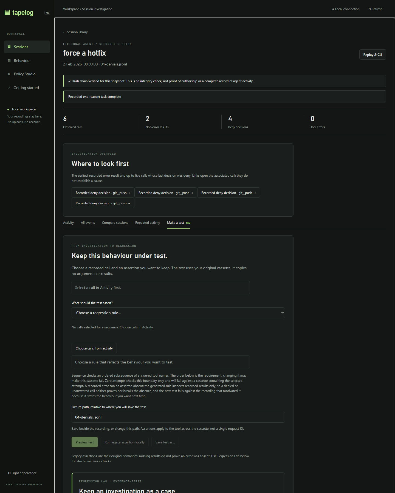
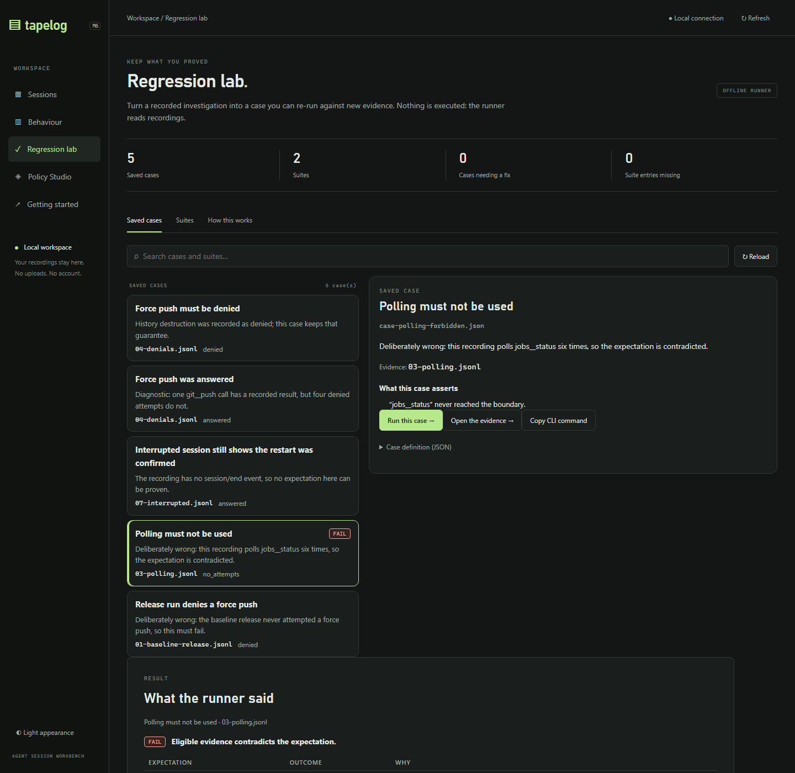
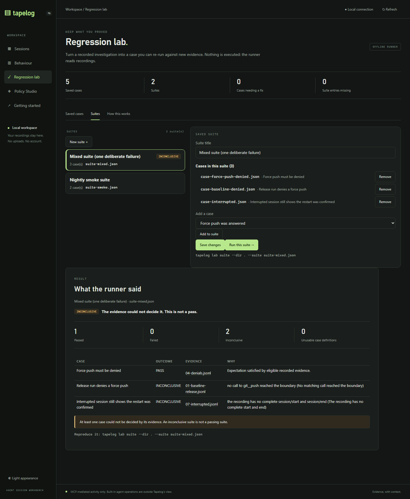
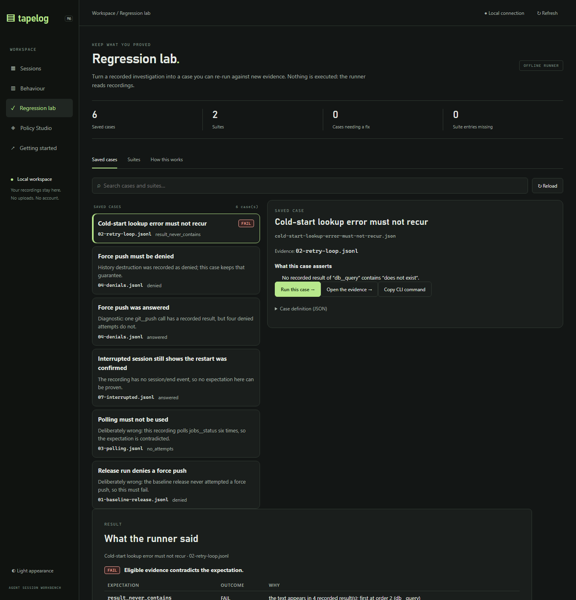

# TAPELOG — M8.1: Regression Lab Completion

**Assigned agent:** Sol · **Role:** lead product engineer, UX/UI specialist and Go developer
**Branch:** `feat/m8-1-regression-lab-completion`, created from `feat/m8-agent-regression-lab`
**Baseline:** `32355bf` "Add initial evidence-aware regression lab" (M8's own candidate)
**Implementation:** `6ec356b` "feat(lab): finish the agent regression lab (M8.1)"
**Nature:** product development, not release preparation. Not pushed, not merged.

M8 built the hard part — a versioned case format, a strict evidence-eligibility
layer, an offline runner and a CLI — and then left it unreachable: no list of
saved cases, no way to open one, no suite interface, no result view beyond one
line inside an existing panel. This milestone finishes the experience so a
developer can create, find, run and understand regression cases without editing
YAML or browsing the filesystem.

---

## 1. Verified baseline

| Item | Value |
| --- | --- |
| Branch point | `feat/m8-agent-regression-lab` at `32355bf` (from M7 `269ab1d`) |
| Working branch | `feat/m8-1-regression-lab-completion` |
| Go / Node | 1.27.3 windows/amd64 · v26.5.0 |
| Packages | 26 `ok`, 0 failures · 23 frontend tests before any change |

M8 lived in an **isolated clone**, not in the main working copy. It was imported
read-only so the whole toolchain (tests, editor, browser) applies to it:

```powershell
git fetch "$src" 'refs/heads/feat/m8-agent-regression-lab:refs/heads/feat/m8-agent-regression-lab'
git switch -c feat/m8-1-regression-lab-completion feat/m8-agent-regression-lab
go build ./... ; go vet ./... ; go test ./...     # green at 32355bf
```

The M8 branch is preserved unchanged; this branch only adds to it.

---

## 2. What M8 shipped, and what was actually missing

| Capability | M8 (`32355bf`) | M8.1 |
| --- | --- | --- |
| Case format, validation, path confinement | yes | unchanged |
| Strict evidence layer (chain, completeness, correlation, 10k events) | yes | extended (§3) |
| Offline runner + CLI + JSON + exit codes | yes | unchanged contract |
| One-record preview/save from a session | yes, to a browser file picker | saves **into the library** beside the recordings |
| **Find a saved case later** | no list anywhere | **Regression lab → Saved cases**, searchable |
| **Open a case** | no endpoint | `GET /api/lab/case` + detail pane |
| **Run a saved case** | no endpoint | `POST /api/lab/run` |
| **Suites in the UI** | CLI only | create, add/remove cases, save, run, inspect |
| **Per-case outcomes** | a suite aborted on one broken case | per-case outcome, `invalid` count, suite continues |
| **Why an outcome** | prose per check, no codes | stable codes + plain-language labels |
| **Comparison** | CLI only, one case | case and suite runs, observational, with caveats |
| **Evidence navigation** | session link | open the recording at the call, from result and suite rows |
| **Deep links** | none | `#lab&case=…`, `#lab&suite=…` |
| **Absence assertion as a case** | rejected by the builder | supported (`error_absent` → `result_never_contains`) |

### 2.1 Before/after UX findings

The starting state, captured before any change:



1. **The lab was a second card inside an existing panel.** To reach it you
   scrolled past a complete, competing workflow ("Preview test / Run legacy
   assertion locally / Save test as…"), then met a second set of buttons with
   different semantics and one muted line of explanation at the very bottom.
2. **Nothing was discoverable.** A saved case was a JSON file at a path the
   browser picker chose. There was no list, no search, no "open", and no way to
   run an existing case at all — the preview only worked on the call selected in
   the timeline.
3. **Suites existed only in the CLI.** The workbench had no suite concept.
4. **One broken case hid the whole suite.** `RunSuiteCandidate` returned an error
   on the first unreadable case, so five good cases reported nothing.
5. **`result_never_contains` could not be created.** The builder's switch
   rejected `error_absent`, so the assertion whose evidence semantics matter most
   was unreachable from the UI.
6. **"Inconclusive" was prose.** Useful sentences, no stable reason, so nothing
   could be grouped, counted or filtered.

---

## 3. Evidence semantics: the defect this milestone fixed

M8's eligibility layer was per-tool and global: if *any* call to the tool had no
recorded result, every expectation about that tool became INCONCLUSIVE. That is
right for a claim about all results and wrong for a claim about one.

Reproduced against the demo library before the change:

```
$ tapelog lab run --dir . --case case-answered-diagnostic.json
INCONCLUSIVE · Force push was answered
  INCONCLUSIVE · answered: a matching call has no recorded result
```

`04-denials.jsonl` records one answered `git__push` call and four denied
attempts. The claim "a `git__push` call was answered" was **satisfied and
provable**, and the tool said it could not tell.

After:

```
$ tapelog lab run --dir . --case case-answered-diagnostic.json
PASS · Force push was answered
  PASS · answered: Expectation satisfied by eligible recorded evidence.
```

### 3.1 The rule now

| Claim shape | Kinds | What counts as enough evidence |
| --- | --- | --- |
| Existential | `answered`, `result_contains`, `denied` | **one eligible witness**. Denied or unanswered siblings are irrelevant to the claim. |
| Universal | `result_never_contains` | **every** matching result. One unanswered call or one redacted body makes absence unprovable. |
| Counting | `attempted`, `no_attempts`, `attempt_ceiling` | the boundary was observed at all. |
| Ordered | `sequence` | at least as many recorded results as the sequence is long. A denied call elsewhere does not falsify an ordered subsequence of answered calls. |
| Boundary | `no_deny_bypassed` | sees every call, not one tool; a recording with no deny decision is **vacuous**, not passing. |

`result_contains` also stops lying in the other direction: a positive match wins
even when another body is redacted, and a redaction marker only produces
INCONCLUSIVE when no witness was found.

### 3.2 Reason codes

Every inconclusive outcome now carries a stable code alongside its sentence:

`no_calls`, `no_results`, `redacted_content`, `missing_decision`, `no_denials`,
`short_sequence`, `incomplete_recording`, `damaged_recording`,
`revision_changed`, `evidence_unreadable`, `invalid_case`.

The interface renders the sentence and, where useful, a plain-language label
("Redacted content hides the answer"). A test asserts that no inconclusive check
can omit its code.

The redaction marker is now the recorder's own `session.Redacted` constant rather
than a loose `"[REDACTED"` prefix match, so the check agrees with what the
recorder actually writes.

---

## 4. Suites: one bad case no longer hides the rest

M8 aborted a suite on the first unreadable or invalid case. A suite is a list
someone maintains over time; one renamed file must not erase nine results.

```
before:  error: case "case-gone.json" cannot be opened        (nothing else runs)
after:   INCONCLUSIVE · Suite: 2 pass, 0 fail, 3 inconclusive (1 invalid)
```

- a missing case, an unparsable case and a case that parses but cannot run all
  become **one inconclusive entry** tagged `invalid_case`, with the reason;
- `SuiteResult` gained an `invalid` count, so the interface can separate "the
  evidence could not decide" from "the definition is broken";
- an invalid entry is counted in `inconclusive` too, because a broken case never
  proves an expectation and must never read as a pass;
- overall status precedence is unchanged: **FAIL beats INCONCLUSIVE beats PASS**;
- a missing case is reported **when the suite is saved**, not only when it runs.

---

## 5. The workbench library

New surface: `internal/web/lab.go` (636 lines) with six endpoints.

| Endpoint | Verb | Purpose |
| --- | --- | --- |
| `/api/lab` | GET | list cases and suites, with evidence presence and missing members |
| `/api/lab/case?file=` | GET | one case: raw JSON, evidence state, revision |
| `/api/lab/case` | POST | create, or replace with the revision the caller read |
| `/api/lab/suite` | POST | create or replace a suite; reports missing members |
| `/api/lab/run` | POST | run one saved case (optional candidate recording) |
| `/api/lab/suite/run` | POST | run a suite; attach per-case comparisons |

Design decisions worth stating:

- **Cases live beside the recordings**, exactly where `tapelog lab run --dir .`
  looks. That is what makes the workbench and the CLI two views of one library
  instead of two libraries. Every run response also names its CLI equivalent, so
  a reader can reproduce it outside the browser.
- **One bounded directory scan**, capped at 500 files, each read through the
  lab's own `ReadLeaf` (os.Root, symlink refusal, size limit).
- **Suite membership is read from the index**, not by adding a second document
  reader: the suite editor works on the parsed index entries.
- Unrelated JSON in the directory is ignored; a document that *claims* to be a
  case but fails validation is listed with its error, because a broken case must
  be visible.

### 5.1 Writing: never silently

The workbench was read-only until now. The write path is deliberately narrow:

| Rule | Implementation |
| --- | --- |
| Only plain `*.json` leaf names | `labLeaf` + `leafName`, no separators, no `..` |
| Only inside the evidence directory | `os.OpenRoot`, temp file + `root.Rename` |
| Never replace what you have not read | `replaces` must equal the SHA-256 of the file on disk, else `409` |
| Create-only by default | an existing file with no `replaces` is refused, never overwritten |
| No recordings touched | `*.jsonl` is not a writable leaf name |
| Invalid definitions never reach disk | the case is parsed and validated first (`422`) |

The session-side builder now saves through this API and, on `409`, offers
*Replace that case* (which re-reads and sends the revision) or *Use a different
title*. Nothing is replaced on a guess.

---

## 6. The interface

A new **Regression lab** view (sidebar → Regression lab) with three tabs. Nothing
is a modal; every state is a URL.



- **Saved cases** — searchable list, evidence file with a *missing* badge when the
  recording is gone, expectation kinds at a glance, and the last outcome of this
  session as a badge. Selecting a case opens a detail pane that restates every
  expectation in words ("No recorded result of “db__query” contains “does not
  exist”."), shows whether the recording still matches the saved revision, offers
  *Run*, *Open the evidence* and *Copy CLI command*, and keeps the raw JSON one
  disclosure away.
- **Suites** — create a suite, add and remove cases, save with revision
  protection, run it, and read per-case outcomes with a clickable evidence file
  and the reason for each.
- **How this works** — the glossary, including *why so strict* and *what is never
  done*. The interface should teach what a regression case is to someone who has
  never made one.



Result presentation rules:

- the status pill is the first thing in the result, with a one-line meaning;
- INCONCLUSIVE always carries an explicit "this is not a pass" note, FAIL carries
  "the evidence contradicts the expectation";
- suite results separate *Passed / Failed / Inconclusive / Unusable case
  definitions*, because those are four different problems;
- every result offers the evidence and the CLI command;
- a comparison is a bordered aside headed "observational", and ends with "a
  difference is an observation. It never changes the case outcome."

Accessibility and layout: the lab tabs are a real tablist with arrow-key
navigation; every control is a button, input or select with a label; the grid
collapses to one column under 1000px; all colours come from the existing theme
tokens (no hard-coded hex, no inline styles — the workbench runs under a strict
`style-src` CSP).

---

## 7. Comparison integration (Phase 4)

A case may name a `reference` recording. When it does, the run response carries
an M7 comparison, and the interface renders counts, caveats and the observational
warning:

| Shown | Source |
| --- | --- |
| New / resolved failure groups | M6 `compareBehaviour` via M7 `BehaviourWorkflowCompare` |
| New / resolved denial rules | same |
| New / resolved repeat patterns | same |
| Tool-usage differences | M7 addition |
| Caveats, including completeness and ambiguity | same |

Suite runs attach a comparison per case that names a reference (bounded to 20 per
suite, with a `comparisons_truncated` flag). Comparisons are **never** folded into
the outcome: an earlier draft of this milestone's plan considered turning a new
failure group into a FAIL, and that would have made the runner a second,
undocumented assertion engine.

---

## 8. Phase 5: the shared-architecture decision

The brief offered a choice: finish the M7 analysis extraction, or document the
boundary precisely and propose a focused task. **I documented it**, because the
extraction is not bounded.

Measured on this branch:

| Piece | Where it lives now | Lines |
| --- | --- | --- |
| Recording discovery, decoding, activity pairing | `internal/web/{sessions,workbench}.go` | ~700 |
| Behaviour analysis, aggregation, comparison | `internal/web/behaviour.go` | 1,444 |
| CLI adapter + payload sanitisation | `internal/web/behaviour_workflows.go` | 266 |
| Already extracted (M7) | `internal/behaviour/{repeats,signature}.go` | 454 |

`cmd/tapelog` imports `internal/web` from four files (`behaviour.go`, `lab.go`,
`record.go`, `web.go`). The lab CLI's dependency is a single call —
`web.BehaviourWorkflowCompare(dir, reference, candidate)` — and
`behaviour_workflows.go` reaches into nine web-internal symbols (`recording`,
`analyseRecording`, `compareBehaviour`, `aggregateOverview`, `decodeRecording`,
`listRecordings`, …).

**The precise boundary:** `internal/behaviour` does not import `internal/web`;
`internal/web` imports `internal/behaviour`; and the CLI reaches through
`internal/web` only for comparison. Unblocking it means moving the analysis plus
a neutral input type (a decoded recording with per-call records) into
`internal/behaviour`, then pointing both `internal/web` and the CLI adapter at
it — roughly 1,700 lines moved and 1,300 lines of tests re-pointed, with parity
tests to prove identical output.

**Proposed focused task for DeepSeek** (not attempted here, because it would
have doubled this milestone's risk surface): move `analyseRecording`,
`compareBehaviour`, `aggregateOverview` and `rowFor` into `internal/behaviour`
behind a `behaviour.Recording` input struct; keep `internal/web` as a thin HTTP
adapter; move `BehaviourWorkflowCompare` into `internal/behaviour` as
`behaviour.CompareRecordings(dir, ref, cand)` with the existing `workflowSafe`
sanitisation; add a parity test that runs the old and new paths over the demo
library and diffs the JSON. The lab itself needs no change: it already consumes
`lab.Result` and a comparison payload, not web internals.

---

## 9. End-to-end acceptance (Phase 8)

The workflow was driven in a real browser against a demo library built from the
M6 generator plus hand-authored cases.

**Record → investigate → create → save → suite → run → inspect**

1. **Record a problematic operation.** `02-retry-loop.jsonl` contains four
   identical failing `db__query` calls with a byte-identical error.
2. **Investigate it.** Sessions → `fix failing report` → the *Where to look
   first* card → the failing call, with its recorded error, policy decision and
   input.
3. **Create a regression case.** *Make a test* → rule *A specific recorded error
   does not recur* → title `Cold-start lookup error must not recur` → *Preview and
   check case*:

   ```
   FAIL · 02-retry-loop.jsonl
   FAIL · the text appears in 4 recorded result(s); first at order 2 (db__query)
   ```

   The preview fails on the recording that motivated it, which is the point: the
   case states the behaviour you want next time.
4. **Save it.** *Save to the lab…* →
   `Saved as cold-start-lookup-error-must-not-recur.json beside your recordings.`
   The file on disk keeps the evidence name, its revision, the selected event
   (`evidence_seqs: [6]`) and the expectation — and no recorded value:

   ```json
   {"version":1,"title":"Cold-start lookup error must not recur",
    "evidence":"02-retry-loop.jsonl","evidence_sha256":"6cdd82bb…",
    "evidence_seqs":[6],
    "expectations":[{"kind":"result_never_contains","tool":"db__query","text":"does not exist"}]}
   ```
5. **Find and reopen it.** Regression lab → it is the first card, badged FAIL;
   selecting it restates the expectation in words.

   
6. **Add it to a suite** — Suites → a suite → *Add to suite* → *Save changes*
   (revision-checked) → *Run this suite*.
7. **Inspect the outcome.**

   ```
   INCONCLUSIVE · Mixed suite (one deliberate failure): 1 pass, 0 fail, 2 inconclusive
     PASS          · Force push must be denied          · 04-denials.jsonl
     INCONCLUSIVE  · Release run denies a force push    · 01-baseline-release.jsonl
     INCONCLUSIVE  · Interrupted session …              · 07-interrupted.jsonl
   ```


### 9.1 The required INCONCLUSIVE demonstration

Three distinct ways to be inconclusive, all from the demo library:

| Case | Why (as the interface states it) | Code |
| --- | --- | --- |
| Interrupted session… | *The recording has no complete start and end* | `incomplete_recording` |
| Release run denies a force push | *No matching call reached the boundary* | `no_calls` |
| `answered` on a tool that was only ever denied | *Every recorded call to X has no recorded result* | `no_results` |

In each case the runner exits **2**, and the interface says "This is not a pass".

### 9.2 Exit-code contract (unchanged from M8, now documented and tested)

| Status | Exit | Meaning |
| --- | --- | --- |
| PASS | 0 | every expectation evaluated and held |
| FAIL | 1 | eligible evidence contradicted an expectation |
| INCONCLUSIVE | 2 | the evidence could not decide |
| invalid input | 1 | the case, suite or path was not usable |

Mixed suites take the worst status: FAIL beats INCONCLUSIVE beats PASS.

---

## 10. Tests

| Suite | Count | Covers |
| --- | --- | --- |
| `internal/lab` | 7 tests (one with 12 sub-cases) | claim-shape eligibility, reason codes, suite containment, unreadable evidence, revision mismatch, strict parsing, damaged/ambiguous evidence |
| `internal/web` (lab) | 7 tests | index with broken cases and missing members, get, create/refuse/stale/valid replace, traversal, directory-as-case, symlink, PASS/FAIL/INCONCLUSIVE runs, CLI↔web parity, suite counts, suite save protection |
| `static/app.test.cjs` | 6 new (29 total) | inconclusive never rendered as success, failure names the outcome and evidence, every expectation explained in words, suite counts separate unusable definitions, comparison stays observational, hostile text stays literal |
| Existing | 26 packages | policy, replay, scenario, session, web and CLI all still green |

```powershell
go build ./...            # ok
go vet ./...              # clean
go test ./... -count=1    # 26 packages ok, 0 failures
node --test internal/web/static/app.test.cjs   # 29 pass, 0 fail
```

### 10.1 Defects the verification found

| # | Defect | Found by |
| --- | --- | --- |
| 1 | `answered` (and `result_contains`) returned INCONCLUSIVE whenever a sibling call had no result — a false "cannot tell" on provable evidence | running the CLI against the demo library |
| 2 | The boundary invariant filtered by tool, so with no tool it saw zero calls and reported `no_calls` | new engine test |
| 3 | `sequence` eligibility counted per-tool and always reported `short_sequence` | new engine test |
| 4 | The lab's own tabs used class `tab`, so the session `setTab` tried to hide a non-existent panel and **broke the session view entirely** | browser walkthrough (console error) |
| 5 | `labFileExists` rejected `.jsonl`, so every case showed "evidence missing" | new web API test |
| 6 | The detail pane rendered blank on first load and the result card was narrower than the grid | screenshot review |

Defect 4 is the clearest argument for the brief's instruction to test real
interactions: the node harness's `querySelectorAll` returns an empty list, so no
markup assertion could have caught it.

---

## 11. Preserved invariants

| Invariant | Status |
| --- | --- |
| Historical `tapelog test` semantics | untouched; the lab is additive |
| Recording integrity | recordings are only read; `session.Verify` still gates every load |
| Recording immutability | the only writable leaf names are `*.json`; `*.jsonl` is refused |
| Replay determinism | `internal/replay` untouched; the lab consumes it |
| Policy enforcement | M5.1 suites still green |
| Redaction | cases never copy arguments or results; a redaction marker makes a text claim inconclusive |
| Safe local dashboard | loopback pinning, token auth, strict CSP, no inline styles, no tool execution, no calls to a server |
| Untrusted content | recordings render through `textContent` only; the node harness still fails on any `innerHTML` |

---

## 12. Remaining limitations

1. **The analysis extraction is not done** (§8). The CLI still reaches into
   `internal/web` for comparison; the boundary and a scoped task are written down
   instead.
2. **No case editing in the UI beyond suites.** A saved case can be reopened and
   re-run, and re-saved from the builder with revision protection, but there is no
   in-place editor for a case's expectations. Editing is deliberate: change the
   recording selection and rebuild, or edit the JSON, which the lab validates on
   read.
3. **No delete.** Removing a case means deleting the file. A destructive action
   with no undo did not seem worth adding in this milestone.
4. **Redaction detection is one marker.** `session.Redacted` is what the recorder
   writes; a recording redacted by some other tool may not be recognised, and a
   text claim over it would be evaluated rather than deferred.
5. **A missing tool is INCONCLUSIVE, not FAIL.** If a case about `git__push` runs
   against a recording that never called it, the answer is "no evidence" rather
   than "contradicted". That is the conservative reading and it is why a case can
   be inconclusive forever on the wrong recording.
6. **Suite ordering is the order of the case list**, with no dependencies or
   parallelism. Enough for an offline runner, and it keeps results reproducible.
7. **Comparisons are counts and caveats, not drill-down.** The lab shows the
   deltas; the per-call comparison stays in Behaviour → Reference comparison.
8. **Case creation is single-expectation.** The builder creates one expectation;
   multi-expectation cases are authored as JSON and validated on read, so a
   mistake is visible rather than silent.
9. **No run history.** The last outcome of the current browsing session shows as a
   badge; nothing is persisted.
10. **Windows-only verification.** No native Linux/macOS run, no live-client test,
    and no accessibility audit beyond the keyboard path exercised here.

---

## 13. Recommended next improvements

1. **Finish the extraction** per §8 — the last architectural blocker, and it
   unblocks "the CLI is not a web client" for M7 *and* M8.
2. **Persist run history** beside the cases (a small JSONL of outcome, timestamp,
   revision and exit code), so a developer can see "this case has failed since
   Tuesday" without a CI system.
3. **CI parity in one command.** The exit-code contract already exists; the recipe
   (`tapelog lab suite --dir . --suite x.json` plus the JSON artifact) belongs in
   `docs/TESTING.md` beside the scenario guidance.
4. **A case editor** for expectations, reusing the builder's rule list with the
   same revision protection the suite editor uses.
5. **Signature-based expectations** (`error_signature_never`) so a case survives a
   message whose literal text changes but whose problem does not — the natural
   follow-on from the M6 review's first recommendation.
6. **Annotations** ("expected polling") in a side store, so a known-good
   inconclusive case can be acknowledged without touching the recording.
7. **Delete and archive**, once there is run history worth keeping.

---

## 14. Final commit

| Item | Value |
| --- | --- |
| Baseline | `32355bf` (M8 candidate, from M7 `269ab1d`) |
| Implementation | `6ec356b` "feat(lab): finish the agent regression lab (M8.1)" |
| This document | the commit that adds it, immediately after `6ec356b` |
| Branch | `feat/m8-1-regression-lab-completion` |
| Push / merge | **not pushed, not merged — awaiting owner approval** |

M8's branch is unchanged; nothing was rewritten, force-pushed or rebased.

