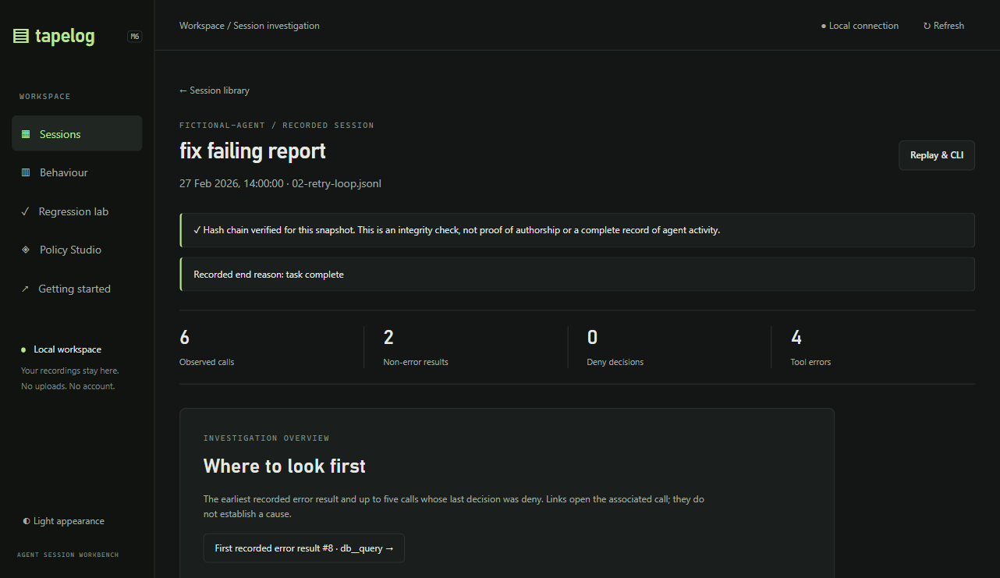
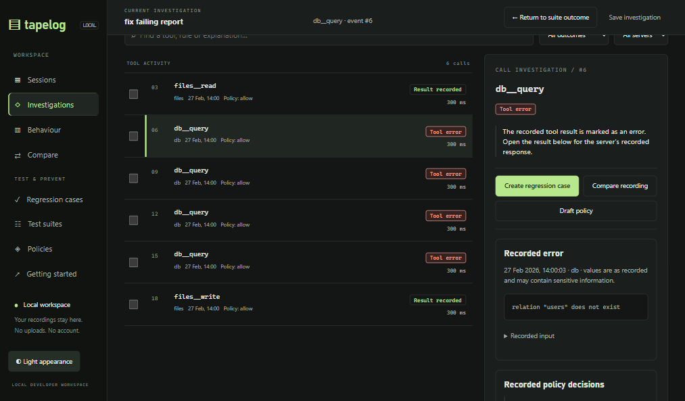
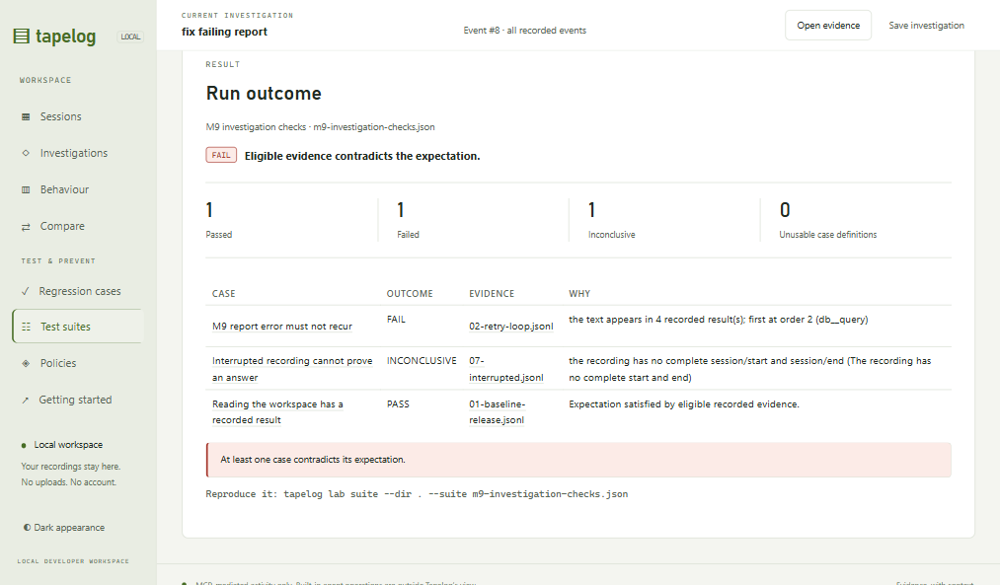
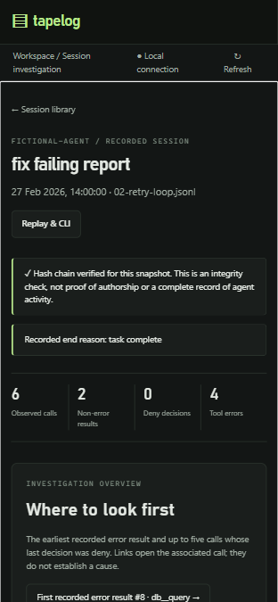
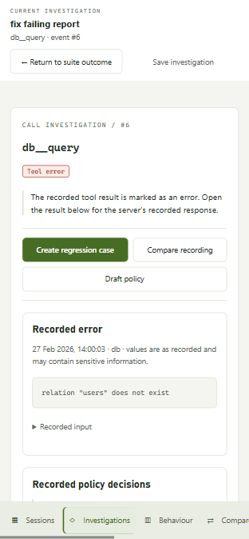

# Tapelog M9 — Unified Developer Workspace

M9 is implemented and locally verified as a product-development candidate. The work connects investigation, comparison, regression testing and policy drafting through the existing engines. It does not authorise a release or claim independent acceptance.

| Item | Verified value |
| --- | --- |
| Baseline | `feat/m8-1-regression-lab-completion` at `a8dda8e2a2ebfd5034a839fdee94686b79c67637` |
| Implementation commit | `00012245fe95d36b58a6feca14c7c71e3670da0e` |
| M9 branch | `feat/m9-unified-developer-workspace` |
| Isolated checkout | `C:\Users\Casey\Documents\Codex\2026-11-07\referenced-chatgpt-conversation-this-is-an-3\work\tapelog-m9` |
| Original checkout | `C:\Users\Casey\Web Apps\agent-boundary` — preserved |
| Execution | Windows/amd64; module-selected Go 1.27.3; Node 26.5.0; BrowserOS neo |

The final documentation commit adds this report and its evidence to the implementation commit above. Nothing was pushed, merged or released. All walkthrough recordings and cases were fictional.

## What the initial walkthrough found

The M8.1 report was read, the exact baseline was built, and its Go suite passed before implementation. Baseline browser inspection covered the session library, call investigation, the test builder, cross-session behaviour, the empty regression library and policy packs. Saved-case and suite workflows were subsequently exercised with explicit fictional cases on M9.

The most significant problems were transitions rather than missing engines:

- The session header, integrity notices, statistics and overview occupied the initial viewport before the timeline. Selecting a call did not consistently carry its event into the URL.
- Comparisons were split between a session tab and a distant section in Behaviour. The same user question required finding two interfaces and choosing recordings twice.
- A strict case builder followed a complete legacy YAML workflow, presenting two sets of preview/run/save controls before explaining their different evidence semantics.
- A failed case could open a recording, but lacked a reliable return path to the specific case or suite outcome.
- An investigation had no explicit save/reopen surface. Navigation did not consistently reset the viewport, and an unavailable recording could leave the previous timeline visible.
- At mobile widths the baseline hid the primary navigation and appearance control. The baseline brand also still displayed “M6”.

**Before, desktop:** the initial investigation hierarchy consumed the screen.

## The unified workspace

The primary navigation now exposes **Sessions, Investigations, Behaviour, Compare, Regression cases, Test suites and Policies**. Cases and suites remain connected through their local tabs, but users can reach either directly from the primary navigation. The milestone badge was replaced with “LOCAL”.

A persistent investigation bar carries the recording, selected call or raw event, and an explicit return action across views. Evidence links record the selected event in the URL. Navigation uses browser history; Back/Forward restores routes, including older session, behaviour-comparison and lab links. A raw-event link opens All events rather than pretending that every event is a tool call.

The selected-call inspector presents **Create regression case, Compare recording and Draft policy** before the technical details. Recorded server error messages are readable as messages, while original JSON remains available in disclosures. The recording integrity explanation is preserved in a disclosure; its caveat is not replaced by a claim of complete agent observation.

**After, desktop:** the linked call, available actions, recorded error and return to the suite are visible together.

### Comparisons

Compare is a single workspace with one reference/candidate pair. It runs the existing call-level comparison and behaviour comparison, presenting recorded calls/decisions alongside failure groups, denial patterns, repetition differences and rates with denominators. Detailed argument hashes and matching internals are a disclosure, rather than the default experience. Duplicate-call uncertainty remains visible. Differences never become failures without an explicit supported assertion.

Changing the reference rebuilds the candidate choices, so the former reference becomes selectable. Comparison URLs retain both recordings. Existing `#behaviour&a=...&b=...` links route to this workspace, and the old session `tab=compare` link still opens comparison functionality.

### Saved investigations

Investigations are explicit browser-local bookmarks: title, recording directory, file, selected event, view and saved revision. They contain no recorded arguments or result bodies. They are bounded to 50 entries, scoped to the recording directory, searchable and removable. Reopening reads the original evidence; a changed revision is explained rather than silently treated as the old snapshot. Unavailable browser storage produces a clear failure message and leaves the URL available for ordinary bookmarking.

This is navigation persistence, not a second recording store or a shared investigation-document format.

### Regression cases and suites

The strict case workflow is now primary. The existing YAML export is retained under **Advanced: legacy YAML test export**. Creating a case from a failed call prepares an error-absence expectation for explicit preview; it does not save or run it automatically. A saved preview provides a direct link into the library.

Case details explain the expectation in words, identify the eligibility mode, offer an explicit candidate recording, link to saved evidence events, and provide reference comparison where configured. Cases can be added to a new or existing suite through its draft editor. Suite searches are accessible from the suite view. The empty suite state retains its create action.

Suite outcomes link to both the case and its evidence. Unsaved membership or title changes disable the run action until saved, avoiding a run against an older membership list. Run actions bring the outcome into view. Returning from evidence restores the cached result and marks it as the last run in the current page session; it does not silently rerun against changed files. Reloading a result link explains that no cached outcome is available and requires an explicit run.

## Explicit evidence semantics

The expected outcomes were specified in `docs/M9-EVIDENCE-SEMANTICS.md` before the new mode was implemented. Existing version-1 cases without an eligibility field preserve M8.1 behaviour. Legacy YAML test-file semantics are unchanged.

New visual cases explicitly store `"eligibility": "complete-boundary"`. Older binaries reject this new field rather than silently applying another meaning. The recording must still pass the global integrity, completion, correlation and revision checks. “Complete” refers to recorded start/end boundaries; it does not establish observation of built-in agent operations or authenticate the recording's author.

| Claim in complete-boundary mode | No matching calls in a verified completed recording | Missing or partial evidence |
| --- | --- | --- |
| `attempted`, `answered`, `denied`, `result_contains` | FAIL: the required recorded witness is absent | Required results or decisions can make the claim INCONCLUSIVE; an eligible witness can decide it |
| `no_attempts` | PASS: zero observed attempts | An incomplete recording is INCONCLUSIVE |
| `attempt_ceiling` | PASS: zero is within the explicit range `0..maximum` | An incomplete recording is INCONCLUSIVE |
| `result_never_contains` | INCONCLUSIVE: there is no result to search | PASS needs every matching result to be available and clear; a known recorded counterexample can FAIL it |
| Answered-tool sequence | FAIL if the required subsequence is not recorded | An incomplete recording is INCONCLUSIVE |

All expectations in an incomplete, damaged or ambiguous recording remain INCONCLUSIVE, including when a witness appears in the partial file. The existing non-vacuous boundary-invariant eligibility is retained. Policy claims use the final recorded decision per call, matching the existing scenario engine.

The scenario engine still decides the assertions. For the new counting mode, the attempt ceiling supplies an explicit minimum of zero; legacy max-only assertions retain their existing implicit requirement for a match. Tests cover absent tools, empty completed sessions, incomplete sessions, missing sibling results, missing decisions, redaction, positive witnesses and known counterexamples. This introduces both justified failures and justified inconclusive results, rather than simply producing more passes.

## Walkthrough evidence

The main path was driven through BrowserOS neo against task-owned loopback servers and fictional recordings:

1. Opened `02-retry-loop.jsonl` (“fix failing report”) and investigated failing `db__query` call **#6**, linked to error result **#8**.
2. Compared recordings `02-retry-loop.jsonl` and `06-mixed-failures.jsonl`. The existing engines reported 6 versus 5 attempts, an uncertain pairing warning, failure/repetition changes, and error-rate denominators of 6 versus 5. These were presented as observations.
3. Created **M9 report error must not recur**, previewed its explicit `result_never_contains` expectation for “does not exist”, and observed FAIL against the motivating recording.
4. Saved it to the case library through the existing revision-protected API, reopened and ran it, then used **Add to suite** to create **M9 investigation checks**.
5. Added an answered-call case and an interrupted-recording case. The suite produced **1 PASS, 1 FAIL, 1 INCONCLUSIVE, 0 invalid definitions**. Its CLI run independently returned exit **1** and the same counts.
6. Opened the failing suite member's saved evidence at call #6, then returned to the same suite outcome, retaining `&outcome=latest` and the cached result. No automatic rerun occurred.
7. Saved **Report lookup · failing query** as an investigation and reopened it on mobile at the same recording and event.
8. Drafted a policy proposal from call #6 and previewed it against the original recording. The existing policy engine re-evaluated **6 calls**, showing **4 new approval requirements and 2 newly blocked calls**. No policy was activated or written by the workbench.
9. Checked ArrowRight/Home session-tab navigation, a raw event #8 deep link, a missing-recording explanation, and browser Back restoration.
10. Opened event **#5999** in a **2,000-call / 6,002-event** recording. The relevant page rendered **50 call rows**, with the late call's evidence visible. A paging-index regression check also covers this path in the existing large-recording test.

The extra long-recording generator uses the existing exclusive filename allocator. Running it twice produced distinct recordings, without replacing a file.

### Desktop and mobile

Desktop walkthroughs used a 1282 × 741 viewport with dark and light appearances. Mobile checks used 390 × 844 browser emulation. Sessions, Behaviour, Compare and suite outcomes had a document width of 390 pixels, with no page-level horizontal overflow in the checked states. The new mobile navigation remains available at the bottom while reading evidence; its horizontal strip can be scrolled to the remaining destinations. Appearance remains accessible. Scroll padding prevents focused controls from being obscured by the navigation bar.

**Before, mobile:** primary navigation was hidden; the initial screen was largely session framing.

**After, mobile:** the selected call, readable evidence, contextual actions and return path remain together. This screenshot uses light appearance.

These are actual browser screenshots, not rendered mockups. The before and after images use the same fictional recording; the after images show the linked investigated call rather than the baseline's initial overview.

## Verification and preservation

| Check | Actual result |
| --- | --- |
| Baseline Go suite | Passed before implementation |
| Fresh full Go suite, `go test -count=1 ./...` | Passed |
| Full suite at the committed implementation, `go test ./...` | Passed; unchanged packages reused Go's valid test cache |
| `go vet ./...` and CLI build | Passed on Windows |
| Frontend suite | **42 passed**, including 13 added workspace regressions |
| New eligibility tests | Matrix and witness/missing-evidence tests passed; old-mode expectations retained |
| Web/offline consistency | New mode, event references and suite case links tested through the real web API and lab runner |
| Existing case on M8.1 and M9 | Identical JSON output; both exited 2 |
| Explicit new-mode CLI examples | Zero-count PASS/0, absent-witness FAIL/1, incomplete-recording INCONCLUSIVE/2 |
| Eight original fictional recordings | SHA-256 hashes unchanged after the walkthrough |
| Runtime identity | Clean build reported `vcs.revision=00012245fe95d36b58a6feca14c7c71e3670da0e`, `vcs.modified=false`; served JS/CSS hashes matched the captured interface source |

Evidence files: [Go output](evidence/m9/go-test.txt), [frontend output](evidence/m9/frontend-test.txt), [CLI mode outcomes](evidence/m9/cli-mode-outcomes.json), [suite CLI JSON](evidence/m9/suite-cli.json), [baseline legacy JSON](evidence/m9/legacy-before.json), [M9 legacy JSON](evidence/m9/legacy-after.json), [runtime/preservation receipt](evidence/m9/runtime-and-preservation.json), and [walkthrough ledger](evidence/m9/walkthrough.json).

The mediator, policy enforcement/compiler, redaction, session-chain and replay source packages were not changed. Their existing tests passed. Historical-format compatibility was checked through existing fixtures/tests and the fictional recordings; private user recordings were not modified. The UI and lab continue to observe recorded MCP traffic only. No live upstream tools were executed by case runs, comparisons or policy simulations.

Browser emulation is not native phone validation. A screen-reader audit, novice usability study, native macOS/Linux execution, race testing and live-client acceptance were not performed. CGO is disabled in this environment. This milestone makes no new release-security or universal compatibility claim.

## Engineering boundary and follow-up

No broad analysis extraction was needed for M9, so it was not combined with the interface work. The remaining seam is explicit:

- `internal/web/sessions.go`: `listRecordings` and `decodeRecording` own bounded discovery and decoded recording/activity types.
- `internal/web/behaviour.go`: `analyseRecording`, `aggregateOverview`, `rowFor` and `compareBehaviour` operate on web-owned types.
- `internal/web/behaviour_workflows.go`: `BehaviourWorkflowCompare` and `workflowSafe` expose and sanitise this analysis for CLI consumers. The lab CLI still reaches this facade through `internal/web`.
- `internal/behaviour` already contains shared signature and repeat detectors. `internal/lab` itself does not depend on web analysis.

A separate bounded task should introduce a neutral decoded-recording input, move analysis/aggregation/comparison and their CLI facade behind it, then keep HTTP handlers and directory/UI coordination in web. Preserve byte-identical existing CLI/web JSON over a fixed fixture corpus, sanitisation, hash-based cache identity, discovery/read budgets, parent-link correlation and ambiguity reporting. Moving type declarations alone would leave the dependency intact; removing sanitisation or changing correlation during the move would risk leaks or misleading comparisons. The recording and policy engines should remain outside that task.

Remaining UX work is bounded: browser-local bookmarks are not portable investigation documents; run outcomes are cached only within the page session; the mobile primary navigation is a horizontally scrollable strip; large catalogues retain their existing limits; and Policy Studio still exposes substantial advanced source when a complex pack is expanded. Portable investigation/run-result artifacts, a compact mobile overflow menu and further novice testing are useful next product tasks. None should require a second assertion engine or speculative causal explanations.

## Reproducing locally

From the isolated checkout, build `go build -o ../tapelog-m9.exe ./cmd/tapelog`, then run the executable with `web --dir ../m9-fictional --listen 127.0.0.1:8952`. The task-created fictional library is outside the source checkout. To make a fresh demo library, use `go run ./tools/gen-m6-demo <new-directory>`; to add a fresh long-navigation recording, use `go run ./tools/gen-m9-navigation <fictional-directory>`. Case and suite files use the existing lab API/CLI formats.

The report/evidence commit is local. Importing the branch into the original checkout, pushing, merging or releasing remains an owner action; none was performed by this milestone.
